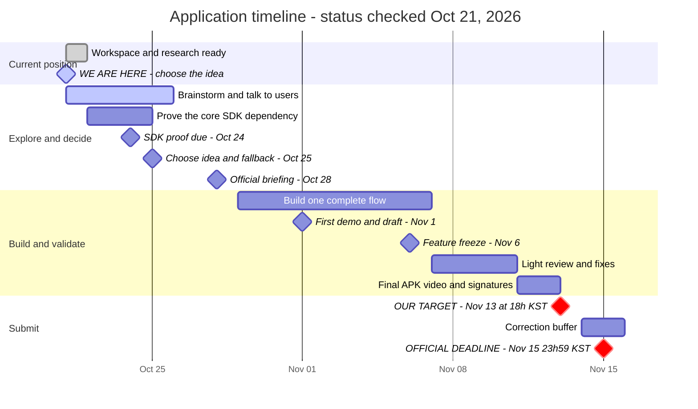

**Goal:** choose one useful vehicle-specific idea, prove the riskiest SDK dependency, and submit a clear proposal with a small working demo.
**Stage:** exploring ideas. No app concept or division of work has been agreed yet.
**Code:** pleos-challenge-lab — private repository · Temporary name; rename after choosing the idea.

## Visual timeline

**We are here:** planning and idea selection, as of 2026년 10월 21일. The Notion hub, research, and starter repository are ready. The idea, owners, SDK proof, app, and submission are still pending.
**Next checkpoint:** prove one core SDK capability by 2026년 10월 24일, then choose the idea by 2026년 10월 25일.
**Our submission target:** 2026년 11월 13일 오후 6:00. **Official cutoff:** 2026년 11월 15일 오후 11:59.

**Reading the chart:** completed = workspace setup; highlighted = current planning phase; red diamonds = our submission target and official cutoff. All other work dates are proposed team targets. The current-position marker is fixed at the status-check date; update it and the task states during your weekly review. It does not track GitHub progress automatically.

See Timeline and next tasks for milestone definitions, owners, and the detailed task plan.

## Start here together

- [ ]  Invite your friend to this page as a guest with Can edit access, and to the GitHub repository.
- [ ]  Each person writes two real frustrations from a recent car journey.
- [ ]  Hold the 45-minute brainstorming session in the Ideas page.
- [ ]  Pick a primary idea and one fallback by 2026년 10월 25일.
- [ ]  Fill in the team details and owners below.

## Team details to fill in

- Team name: **TBD**
- Representative: **TBD**
- Friend / second member: **TBD**
- Hours available per person per week: **TBD**
- Primary idea / fallback: **TBD / TBD**
- Product and proposal owner / app and SDK owner: **TBD / TBD**

## Dates that matter

**Official application deadline:** 2026년 11월 15일 오후 11:59. Confirmed in the official application form.
**Our proposed submission target:** 2026년 11월 13일 오후 6:00. This is an internal target, not an organizer deadline.
Online briefing: 2026년 10월 28일 afternoon, exact time/link to be announced; replay planned. First results: 2026년 11월 23일. Offline PT: 2026년 12월 3일 → 2026년 12월 4일. Final selection: 2026년 12월 18일. Exhibition/awards: February 2027. Official schedule

## How we work

Notion holds ideas, decisions, and the short task list. KakaoTalk handles quick discussion; record each decision here. GitHub holds code and technical bugs. Use short branches and review changes before merging; one owner per task. A 20-minute weekly check-in is enough.

## Decisions

Add a line after each discussion: **Date / Decision / Why / Owner / Next step**.
No product decision yet. The idea ranking and timeline in this hub are proposals for us to review.

## Project pages

Research, ideas, timeline, and the submission worksheet are attached below.

Research and SDK feasibility

Ideas and 45-minute brainstorming

Timeline and next tasks

Submission worksheet

Pleos App Challenge HQ