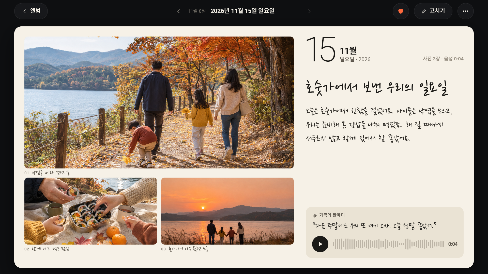
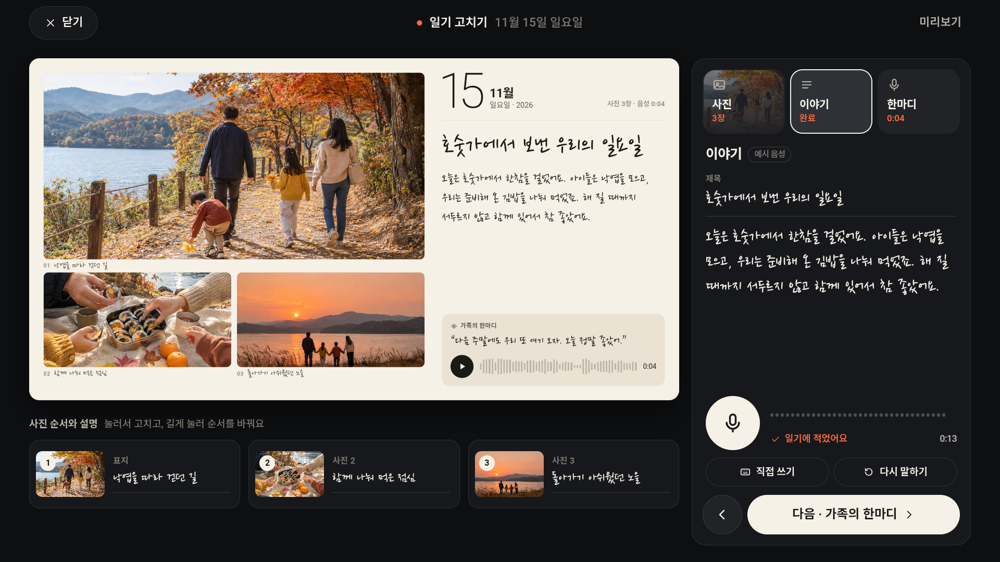

# Pleos Journal — 앱 시연 v4.1

가족의 나들이 사진, 이야기와 한마디를 하루의 일기로 모으고, 앨범과 달력에서 다시 꺼내 보는 Android 인터랙티브 데모입니다.

**[영상, APK, 전체 파일 다운로드](https://github.com/seongung/pleos-challenge-lab/releases/tag/pleos-journal-v4.1)**

| 자료 | 링크 |
| --- | --- |
| 실제 앱 사용 영상, 1분 46초 | [MP4 다운로드](https://github.com/seongung/pleos-challenge-lab/releases/download/pleos-journal-v4.1/Pleos-Journal-Showcase-v4.1.mp4) |
| 설치 가능한 Android 데모 | [APK 다운로드](https://github.com/seongung/pleos-challenge-lab/releases/download/pleos-journal-v4.1/Pleos-Journal-v4.1.apk) |
| 소스 코드와 빌드 스크립트 | [ZIP 다운로드](https://github.com/seongung/pleos-challenge-lab/releases/download/pleos-journal-v4.1/Pleos-Journal-Source-v4.1.zip) |
| 배경 음악 | [MP3 다운로드](https://github.com/seongung/pleos-challenge-lab/releases/download/pleos-journal-v4.1/Pleos-Journal-Instrumental.mp3) |





## 영상에서 보여 주는 흐름

즐겨찾기에 저장된 바닷가 추억 열기 → 오늘의 사진 3장 고르기 → 이야기 받아쓰기 → 가족의 한마디 추가 → 완성된 일기 미리보기 → 앨범에 저장 → 달력에서 다시 열고 음성 재생.

일기의 제목, 본문, 사진 설명과 가족의 말에는 나눔손글씨펜을 적용했습니다. 메뉴, 날짜, 버튼은 기존 글꼴을 유지합니다. 별도 Claude Code 디자인/구현 세션에서 작업했고, Android 에뮬레이터의 실제 화면을 녹화했습니다.

## 실행과 구현 범위

- Android 8 이상, 가로 화면. Android 15 에뮬레이터 1920×1080에서 검증했습니다.
- 패키지: `io.pleos.familyjournal.demo`. 설치 가능한 **debug 서명 프로토타입**입니다.
- 사진 선택, 편집, 즐겨찾기, 달력 탐색, 로컬 저장과 다시 열기는 동작합니다.
- 받아쓰기와 가족 음성은 사전 녹음된 예시입니다. 실시간 음성 인식, AI 생성, 클라우드 동기화와 차량 연동을 구현한 제품은 아닙니다.
- 모든 인물과 기록은 가상의 데모 콘텐츠입니다.
- 이 폴더는 시연용 별도 앱입니다. 저장소 루트의 기존 Kotlin/Pleos SDK 앱과 구분됩니다. 실차 또는 Pleos Connect 환경 검증을 주장하지 않습니다.

## 소스에서 빌드

이 폴더에서 JDK 17과 Android SDK platform/build-tools 35.0.0을 준비한 뒤 실행합니다.

```sh
JOURNAL_DIR="$PWD/family-journal-v4.1" ./android-demo/build.sh
```

결과: `android-demo/dist/PleosJournal-debug.apk`.

- `family-journal-v4.1/`: UI, 사진, 음성, 손글씨 폰트와 라이선스
- `android-demo/`: Android WebView 앱과 빌드 스크립트
- `android-tooling/`: 실제 탭 녹화 계획, 캡처와 음악 믹싱 스크립트
- `design-v4/`: 디자인 기준, Mobbin 참고 링크, 손글씨 적용 명세
- `QA.json`: 검증 범위
- `ASSET-NOTES.md`: 이미지, 음성, 음악, 글꼴 출처

API 자격 증명, 서명 키, 빌드 캐시는 포함하지 않았습니다. 원본 음악은 Release의 MP3로 제공합니다. 녹화 스크립트의 SDK 경로와 에뮬레이터 serial은 실행 환경에 맞게 조정해야 합니다.
